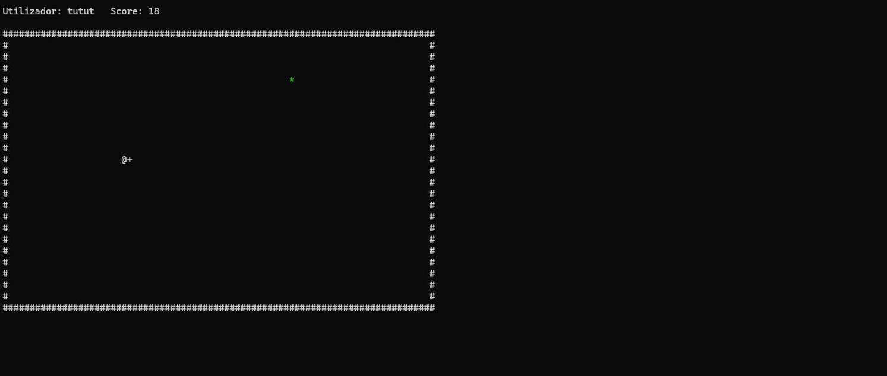
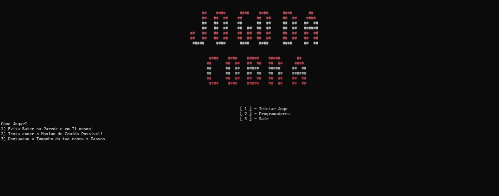
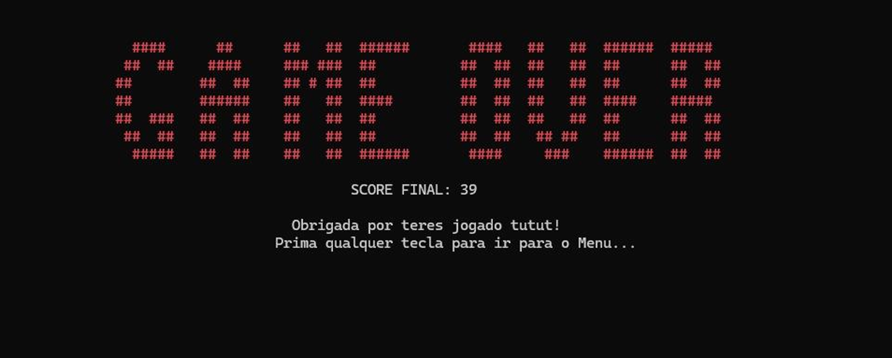
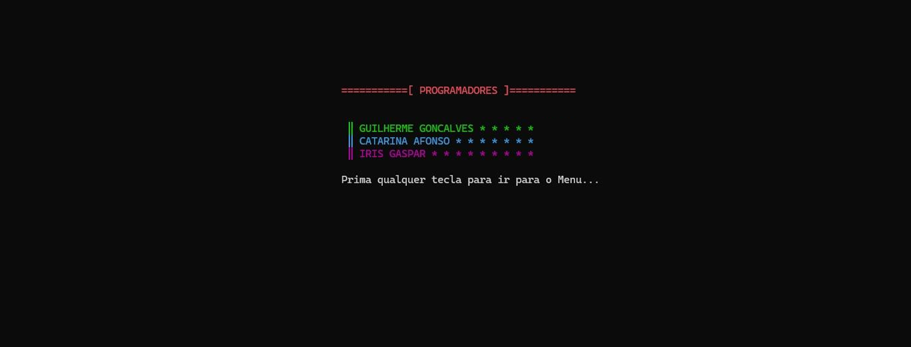

# Snake Game in x86-64 Assembly

A fully playable Snake game written in x86-64 Assembly (MASM) for the Windows console, developed as the final project for the Microprocessors course at NOVA School of Science and Technology (FCT NOVA).

## Features

- ASCII art title screen and start menu (Play / Developers / Exit)
- Player name input and high score kept between rounds
- 80 x 25 playing grid with walls
- Random food generation; the snake grows with every item eaten
- Real-time controls with protection against reversing direction
- Collision detection with the walls and with the snake's own body
- Live score and a GAME OVER screen with the final score
- Colors and sound effects through the Windows API

## Controls

| Key | Action |
|-----|--------|
| W / Up arrow | Move up |
| S / Down arrow | Move down |
| A / Left arrow | Move left |
| D / Right arrow | Move right |

## How it works

- The snake's body is stored as two arrays of coordinates (`snakeX`, `snakeY`), shifted on every move.
- Keyboard input is read without blocking the game loop using `_kbhit` and `_getch`.
- Drawing uses `SetConsoleCursorPosition` to update only the cells that change, instead of redrawing the whole screen.
- Colors use `SetConsoleTextAttribute`, sound uses `Beep`, and the game speed is controlled with `Sleep`.

## Build and run

1. Open Visual Studio and create an empty C++ project (x64).
2. Enable MASM: right-click the project > Build Dependencies > Build Customizations > check **masm**.
3. Add `snake.asm` to the project.
4. Set the platform to **x64** and run.

Full project report (in Portuguese): [Relatorio_Snake.pdf](Relatorio_Snake.pdf)

## Screenshots

| Menu | Game Over |
|------|-----------|
|  |  |

## Authors

- Catarina Afonso
- Guilherme Gonçalves
- Íris Gaspar
